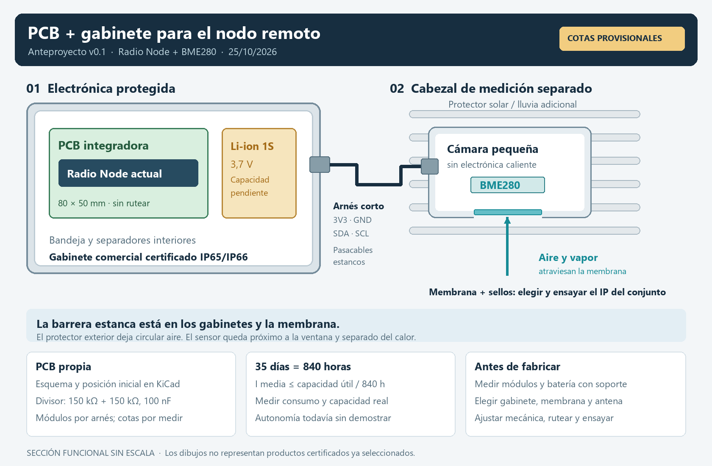

# Nodo remoto: PCB integradora y gabinete

Anteproyecto v0.1 - 25/10/2026. **Base editable para revisar; PCB sin rutear y geometrías provisionales. No liberar a fabricación.**

La cátedra permite integrar los módulos actuales en una PCB propia, según lo confirmado por el usuario. El lugar de instalación no está definido: se conserva la posibilidad de uso exterior. La alimentación será una celda Li-ion de 3,7 V nominal; faltan capacidad, formato y dimensiones.

## Decisión de arquitectura

1. **Gabinete principal comercial con certificación IP65/IP66:** Radio Node, PCB integradora y batería, con tapa y junta del fabricante.
2. **Cabezal de medición separado:** BME280 en una cámara pequeña, sin fuentes de calor, próxima a una ventana con membrana hidrófoba permeable al aire y al vapor. La membrana se instala sobre la abertura de la cámara, sin tocar ni tapar directamente el encapsulado del sensor. Seleccionar un conjunto documentado para el IP objetivo.
3. **Protector solar y de lluvia exterior:** pantalla de platos o capota clara alrededor del cabezal, con circulación de aire. Es una protección adicional y no constituye la barrera estanca.
4. **Cable corto entre ambos:** 3V3, GND, SDA y SCL; entrada estanca y alivio de tensión en cada extremo. Longitud inicial de ensayo: 100 mm, no longitud máxima garantizada.

Un gabinete puede impedir el ingreso de agua líquida y permitir intercambio de aire/vapor mediante una membrana apropiada. Hacer agujeros abiertos en la caja principal comprometería su protección. Una membrana en un volumen grande que contiene electrónica caliente tampoco garantiza una buena medición ambiental.

Bosch recomienda reducir el volumen muerto, acercar el sensor al ambiente y reducir su acoplamiento térmico con la placa y las fuentes de calor. También indica proteger el puerto de luz directa y evitar recubrimientos o sustancias que contaminen el sensor. La membrana y la cámara deben evaluarse por su retardo de respuesta, además de su protección al ingreso. [Guía de montaje Bosch BME280](https://www.bosch-sensortec.com/media/boschsensortec/downloads/handling_soldering_mounting_instructions/bst-bme280-hs006.pdf).

**El IP del gabinete comprado no certifica automáticamente el equipo modificado.** Registrar referencia y certificados de gabinete, membrana, pasacables y salida de antena; documentar montaje y verificar el conjunto final. Una caja impresa o una pantalla de platos no se presentarán como gabinete IP65/IP66 certificado. La cápsula del sensor también forma parte del alcance de protección del nodo.

## Requisitos y evidencia pendiente

Fuente: `PBL_TeoCom-SisCom-2026-final.pdf`, páginas 1 y 2.

| Requisito | Respuesta de esta etapa | Evidencia pendiente |
| --- | --- | --- |
| Temperatura, humedad y presión | BME280 separado térmicamente | Comparación de caja abierta/cerrada y referencia |
| PCB propia bajo IPC-2221 o similar | Esquema y distribución inicial de placa integradora | Revisión de reglas, esquema final, ruteo y DRC |
| Gabinete certificado IP65/IP66 | Carcasa comercial y accesorios documentados | Elegir referencias, certificados y ensayo del conjunto |
| Enlace al gateway | Se conserva el Radio Node de 915 MHz | Medir enlace en montaje definitivo y con antena elegida |
| Mínimo 35 días de autonomía | Presupuesto energético definido abajo | Capacidad útil, consumo promedio y prueba de duración |
| Batería y RSSI | ADC A0 y RSSI del receptor existentes | Calibración y ensayo con alimentación real |
| Pantalla, base de datos, Web, App y alarmas | La pantalla está contemplada en el firmware existente; los demás puntos siguen fuera de esta etapa | Validación e integración del sistema completo |
| Documentación y ensayos | Este anteproyecto y archivos editables | Memoria final, manual y resultados ejecutados |

No se afirma conformidad con IPC ni IP a partir de este anteproyecto. Los valores de reglas propuestos son decisiones iniciales, no una transcripción de tablas normativas. Consultar la edición de la norma adoptada por la cátedra y las capacidades del fabricante de PCB. [IPC: normas de diseño](https://www.ipc.org/ipc-design-standards), [IEC 60529: alcance del código IP](https://webstore.iec.ch/en/publication/2447).

## PCB integradora v0.1

Abrir `pcb/NodoIntegrador.kicad_sch` y `pcb/NodoIntegrador.kicad_pcb` con KiCad 10. Los símbolos están embebidos y las huellas colocadas están guardadas en la placa. El Radio Node se conecta por arnés; **no se ha inventado una huella de módulo sin medirlo**. Su posición dibujada es solo una reserva y necesita soporte mecánico.

- Contorno inicial: **80 x 50 mm**, dos capas, FR-4 de 1,6 mm. Cotas modificables.
- Cuatro fijaciones provisionales: taladro de 3,2 mm, centros a 4 mm de cada borde; patrón 72 x 42 mm.
- Batería y conexiones de alimentación en una zona; bus del sensor en otra.
- Reserva inicial de módulo: 40 x 20 mm, **sin verificar contra la placa física**.
- R1/R2 de **150 kΩ, 1 %**, C1 de 100 nF en el ADC; coincide con el `Config.h` actual. También se actualizó el README principal para corregir los datos antiguos del divisor y de su habilitación.
- R3/R4 de 4,7 kΩ son **DNP (no montar inicialmente)**: verificar primero los pull-ups del módulo BME280 y de cualquier otra placa. Si hacen falta, calcular el valor con la capacitancia y el tiempo de subida del bus.
- C2 de 100 nF en la alimentación del conector del sensor. Verificar además el desacoplo existente junto al BME280.
- J5 conecta un interruptor interno en serie con la batería. No es un punto de programación ni un puente que deba cerrarse por defecto.
- Sin cargador ni protección de celda en esta PCB: entrada prevista desde una celda/pack 1S con protección adecuada. Dimensionar cableado, protección y conector cuando se confirme la batería. Verificar el rango real de la entrada de batería de la revisión del Radio Node disponible.

### Interfaces propuestas

Todos los números siguientes pertenecen a **la PCB nueva**. No copiar el orden a ciegas al módulo. Los headers de 2,54 mm son huellas de trabajo; sustituir conexiones de batería y cabezal por conectores polarizados y con retención adecuados al montaje final.

| Conector | Pin | Señal | Destino |
| --- | --- | --- | --- |
| J1 | 1 / 2 | BAT_PROT / GND | Celda Li-ion 1S protegida; hasta 4,2 V |
| J5 | 1 / 2 | BAT_PROT / VBAT_SW | Interruptor interno; abierto = apagado |
| J2 | 1 / 2 | VBAT_SW / GND | Entrada de batería del Radio Node |
| J3 | 1 / 2 / 3 / 4 / 5 | 3V3 / GND / SDA / SCL / VBAT_ADC | 3V3 y GND del nodo, A4, A5 y A0 |
| J4 | 1 / 2 / 3 / 4 | 3V3 / GND / SDA / SCL | Módulo BME280 externo |

La salida 3V3 del Radio Node alimenta al BME280 a través de J3/J4. No hay regulador adicional en esta placa y no se debe llevar VBAT a la red 3V3.

El esquema original IOT-MCU muestra su conector de batería J1 con **pin 1 = GND, pin 2 = VBAT**, orden distinto al J2 propuesto aquí. Confirmar la placa física y preparar el arnés por función, no con un cable asumido directo. La entrada de batería del módulo es distinta de su pin 3V3. No usar simultáneamente dos baterías; revisar también la alimentación del adaptador de programación para evitar unir fuentes inadvertidamente. [Esquema original IOT-MCU](https://github.com/IOT-MCU/LoRa-Radio-Node-v1.0).

Divisor: `VBAT_SW -> R1 -> VBAT_ADC -> R2 -> GND`, con `C1` entre `VBAT_ADC` y `GND`. A 4,2 V, el ADC recibe aproximadamente 2,1 V y el divisor consume 14 µA. Su contribución máxima aproximada en 840 h es 11,76 mAh. La resistencia de Thévenin es 75 kΩ y con 100 nF resulta una constante de tiempo de 7,5 ms. Verificar asentamiento y referencia ADC en hardware; el firmware actual calibra VCC con 3226 mV, valor específico del montaje existente.

La cadena de diodo y regulador del Radio Node puede perder regulación al bajar la batería. Medir el límite de operación del montaje: afecta tanto la capacidad de batería realmente aprovechable como la lectura ADC referida a VCC. No suponer que 3226 mV permanece constante durante toda la descarga; puede ser necesario revisar la regulación o cómo el firmware determina su referencia.

Reglas iniciales para revisar antes del ruteo: separación 0,25 mm, señales 0,30 mm, alimentación 0,80 mm y cobre separado al menos 0,50 mm del borde. Calcular anchos con corriente de pico, caída admisible y espesor de cobre reales. Mantener el retorno de RF/alimentación lejos de la toma de ADC; ubicar C1 junto a la conexión A0. No se lleva RF por esta placa: conservar el conector y coaxial del módulo. El espacio libre de antena se definirá con la antena seleccionada.

## Caja y piezas mecánicas

Abrir `mecanica/AnteproyectoNodo.FCStd` en FreeCAD. Los objetos marcados **REFERENCIA** representan volúmenes para estudiar el montaje; no son modelos de un gabinete certificado seleccionado.

| Elemento | Dimensiones iniciales | Estado |
| --- | --- | --- |
| Caja principal | 120 x 80 x 60 mm exteriores | Volumen de referencia, sin modelo comercial elegido |
| PCB | 80 x 50 x 1,6 mm | Base modificable |
| Bandeja | 88 x 58 mm; base de 3 mm; separadores de 6 mm | Pieza propia de prueba; fijación a caja pendiente |
| Batería | 70 x 22 x 22 mm de reserva | No define formato ni capacidad; medir pack con soporte |
| Cámara de sensor | 40 x 35 x 25 mm de referencia | Falta elegir cápsula, sellos, membrana y soporte |
| Protector exterior | 70 mm de diámetro, 6 platos | Concepto geométrico; estudiar ventilación y montaje |

La bandeja tiene agujeros que coinciden con la PCB provisional. No perfora por sí misma la caja: adaptar su fijación a los postes interiores del gabinete elegido. El STL de bandeja sirve para una prueba de ajuste, no acredita estanqueidad. Elegir material definitivo por temperatura y exposición; estudiar dilatación, rigidez y envejecimiento de las piezas expuestas.

Ubicar el cabezal fuera de la pluma de aire caliente de la caja y de superficies calentadas por el sol. La ventana de membrana queda próxima al sensor, con pequeño volumen de aire. El protector debe dejar aire alrededor y evitar radiación directa, chorros y acumulación de agua. Las dimensiones dibujadas de ventana y entrada de cable son únicamente reservas; se definirán con los accesorios seleccionados. Evitar que la tapa o su junta aprieten el coaxial o los cables. Una antena exterior necesita un pasamuros sellado documentado; una antena interior necesita comprobar rendimiento dentro del material y geometría reales.

La permeabilidad al vapor depende de la membrana concreta. No asumir que cualquier respiradero, espuma, tela o producto que declare solo IP68 cumple IP65/IP66 o la respuesta de humedad buscada. Pedir ensayo para los grados requeridos y condiciones de montaje. [Gore: intercambio de vapor y aire](https://www.gore.co.uk/node/34066), [Gore: respiraderos y documentación por producto](https://www.gore.com/products/screw-protective-vents-outdoor-electronics-enclosures).

## Autonomía de 35 días

35 días = **840 horas**. Medir corriente del conjunto completo en el lado de la batería, incluyendo regulador, indicadores, sensor, divisor y pérdidas. Para una capacidad útil medida `C_util`:

`I_prom_max [mA] = C_util [mAh] / 840 [h]`

Ejemplos de presupuesto con una fracción utilizable **supuesta** del 80 %; no son una recomendación de compra ni una autonomía comprobada:

| Capacidad nominal | Capacidad utilizable supuesta | Corriente media máxima |
| --- | --- | --- |
| 1000 mAh | 800 mAh | 0,95 mA |
| 2000 mAh | 1600 mAh | 1,90 mA |
| 3000 mAh | 2400 mAh | 2,86 mA |

El firmware actual toma el BME280 en modo forzado, duerme la radio entre envíos y transmite cada 5 s; el ATmega sigue ejecutando esperas con `delay`, sin suspensión profunda. No demuestra aún 35 días. Caracterizar primero reposo, lectura y transmisión, y luego elegir intervalo, suspensión, batería y protección. Para eventos periódicos: `I_prom = [I_reposo*(T-t_activo) + suma(I_i*t_i)] / T`, con estados sin solaparse y unidades coherentes. Incluir reintentos, arranque y variación de batería/temperatura.

## Ensayos propuestos (todavía no ejecutados)

1. **Alimentación:** continuidad y ausencia de corto sin batería; verificar polaridades de los arneses; alimentar con fuente limitada; medir 3V3 y estabilidad durante TX. Confirmar corte de batería y protección con la documentación del pack.
2. **ADC:** medir batería y punto medio con multímetro; comprobar aproximadamente VBAT/2; comparar varios estados de carga y calibrar VCC. Registrar errores antes y durante actividad RF.
3. **Sensor/cable:** comprobar identidad BME280, dirección I2C y pull-ups; registrar errores de bus y tiempos de subida con el arnés definitivo. El firmware actual usa 100 kHz; ajustar si el ensayo lo exige.
4. **Efecto de caja:** colocar el mismo sensor primero libre y luego en el cabezal final, junto a una referencia estable; registrar T, HR y P hasta estabilización con radio activa/inactiva y batería en descarga. Evitar moverlo entre ambientes distintos durante la comparación. Fijar previamente con la cátedra sesgo y retardo aceptables; no existen umbrales de precisión en la consigna.
5. **Cambios de ambiente:** medir tiempo de respuesta al cambio de T/HR y recuperación tras ambiente húmedo, sin mojar directamente el sensor. Una lectura estable por sí sola no prueba exactitud.
6. **Sol y lluvia:** comparar el cabezal sombreado con el ambiente y documentar calentamiento y funcionamiento del protector en condiciones representativas.
7. **Protección IP:** conservar certificados y procedimiento aplicable; ensayar la configuración final con los accesorios y orientación definitivos según el grado declarado. Un rociado doméstico es una prueba preliminar, no evidencia de certificación. La consigna pide verificación empírica y gabinete certificado.
8. **Enlace y energía:** RSSI y paquetes perdidos con la caja cerrada, corriente integrada por ciclo y capacidad útil; ensayo de duración y registro de los 35 días.

## Orden de continuación

1. Medir Radio Node y BME280: largo, ancho, alto, headers, taladros, salientes, antena y programación. Confirmar capacidad y tamaño real de la batería con portacelda/protección.
2. Elegir gabinete y cabezal certificados/documentados, membrana, pasacables y antena. Importar sus planos CAD y comprobar espacio útil, alturas y acceso a tornillos.
3. Ajustar contorno, arneses, conectores y bandeja; revisar esquema contra módulos físicos. Mantener acceso a programación sin abrir una nueva entrada sin sello.
4. Rutear, ejecutar ERC/DRC completos, revisar mecánica y recién entonces exportar Gerbers y planos definitivos.
5. Construir y ejecutar los ensayos anteriores; adjuntar resultados a la memoria.

Archivos auxiliares: `parametros.json` centraliza cotas provisionales; `pcb/BOM.csv` y `pcb/CONEXIONES.csv` registran componentes y señales; `VERIFICACION.md` informa comprobaciones efectivamente ejecutadas. Los scripts permiten regenerar este anteproyecto; si se editan los archivos CAD manualmente, guardar una copia antes de regenerar.
